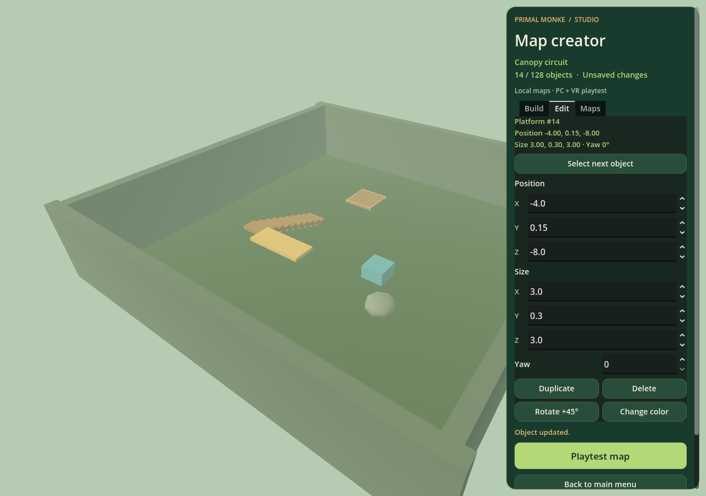

# Primal Monke — native PC and Quest crossplay

This **Godot 4.6.3 OpenXR game** builds a Windows x64 executable and an ARM64 Quest APK. Version **0.7.1** fixes developer access for titles using **PMDID** and improves standing VR arm reach. It includes a local map creator with six save slots, undo/redo, object editing, and PC/VR playtesting. A clearer main menu, compact desktop HUD, updated loading screens, forest sky, and lightweight ground details improve the presentation. Up to eight PC and Quest players can share the original forest in Co-op chase or Player Tag. Accounts, profiles/PFPs, cosmetic levels, optional voice, tutorials, and saved settings remain available. Solo play and map creation work without an account connection.

The Unity **2021.3.21f1** and WebXR projects remain separate single-player versions. They cannot join these native multiplayer sessions. The forest, monkeys, icon, and audio are original; no Gorilla Tag assets or code are included.

## Install on Windows

Download [PrimalMonke-Windows.zip](../pc/README.md) and extract every file into one folder. **Play-Desktop.bat** starts keyboard/mouse mode; **Play-PCVR.bat** starts headset mode. Game data and the custom Windows app icon are embedded in `PrimalMonke.exe`. The executable is unsigned. Windows execution and real PC VR rendering remain untested in this Linux workspace.

For PC VR, connect your headset and start its active **OpenXR runtime** before launching. Quest Link/Air Link with the Meta OpenXR runtime, or another configured PC OpenXR connection, can provide Quest PC VR. SteamVR can serve as the active runtime for a supported headset. The runtime must support OpenGL graphics bindings.

The PC VR launcher passes `--xr-mode on -- --play-mode=pcvr`; the desktop launcher passes `--xr-mode off -- --play-mode=desktop`. Launching the EXE directly retains automatic VR detection. **PC VR** / **Desktop** in the main menu restarts the game to switch modes; leave an online room first. If the headset runtime is unavailable, the game displays a message asking you to start it and retry. Restarting requires fresh credential sign-in.

## Install on Quest

Enable developer mode on your headset, connect over USB, and authorize debugging. Sideload `PrimalMonke-Quest.apk` using SideQuest or:

```sh
adb install -r PrimalMonke-Quest.apk
```

Launch **Primal Monke** from Unknown Sources. The package identifier is `com.grec26.primalmonke`. This is a debug-signed local test build for a Quest headset, not a phone or store release.

## Play and controls

Startup shows resource-loading progress, then offers **Create account** or **Continue as guest** on first launch. The main menu opens solo play, the multiplayer lobby, Map creator, Account, Profile, Tutorial, Settings, and Voice. No round starts until you choose **Play solo** or the room's host chooses **Start match**. In VR, aim the right controller and pull its trigger to select menu buttons.

| Action | Desktop | Headset |
| --- | --- | --- |
| Move and climb | WASD; hold right mouse to look; Space to jump | Push solid surfaces with tracked controllers; release to launch |
| Tag | E near a monkey/player | Touch the target with a tracked hand |
| Restart solo or a hosted round | R | Right A |
| Main menu | F1 | Main menu button in the room menu |
| Main menu offline / room menu online | Tab | Right B |
| Account | F3 | Left X, or main menu |
| Developer tools, with permission | F2 | Left Y |
| Settings | F7 / Main menu | Main menu |
| Map creator / return from map playtest | F8 / Main menu | Main menu; right B returns from playtest |
| Tutorial / Profile / Voice | F4 / F5 / F6 | Main menu buttons |
| Speak, after enabling voice | Hold V during captured gameplay, or unmute in Voice | Unmute/mute in Voice |

**Play solo** starts a 90-second chase: tag all five brown AI monkeys; tagged monkeys turn orange and stop. Climb trees, rocks, branches, and the treehouse. Menus pause your local input; an online round continues for other players. **Resume game** returns to the existing round without resetting it. Leaving during a loading transition cancels it; returning from the room menu to **Main menu** disconnects the room.

The optional **Tutorial** includes movement, jump/hand-contact, and tag exercises that check your actions. It can be skipped or reopened; opening it during an online game does not restart or leave the room. Menu clicks, hand pushes, landings, tags, wins, errors, and level changes have original sound cues, with quiet forest ambience.

Tracking/focus loss pauses that player's movement and tags. Recenter clears hand anchors and launch momentum. In multiplayer, the shared round continues while another player is active.

In VR, lower the monkey hands to the ground and push them backward to move forward while standing upright. Lift your hands to release the push; plant them on a wall and pull downward to climb. Longer virtual arms provide ground reach while your headset view and controller menu rays continue to use the tracked poses.

## Crossplay

1. Install matching **0.7.1** Windows and Quest builds and connect devices to the same local network. Guest Wi-Fi/client isolation can block connections.
2. Choose **Multiplayer lobby**. One player selects **Host** and shares the local IPv4 address shown in the lobby. On Windows, allow the game through the firewall for your private network.
3. Other players enter that address and select **Join**. VR has a controller-operated IPv4 keypad. Public names, levels, and pictures appear in the room roster.
4. While the room is waiting, the host selects **Co-op chase** or **Player Tag** with the mode button. Co-op shares the five AI monkeys, score, and countdown. Player Tag requires at least two players: one orange player is IT and transfers the role by tagging another player; a short cooldown prevents immediate tag-back.
5. The host selects **Start match**. Players load the forest together, then enter the 90-second round. Movement, tags, and the timer remain paused while the lobby waits. Only the host can restart the shared round.

**Leave** returns to an offline lobby; **Main menu** disconnects and returns to the main screen. Host loss during play returns clients to solo; disconnecting during preparation returns to the offline lobby. Starting solo always selects Co-op chase.

ENet uses **UDP 7777**, protocol **2**, and a maximum of eight players including the host. For internet connections, forward UDP 7777 to the host and use the host's public IPv4 address; carrier-grade NAT may require a VPN with direct peer connectivity. There is no hosted lobby service, relay, automatic NAT traversal, or public matchmaking.

The host owns bots, timer, mode changes, and accepted tags. Clients send head/hand poses at 20 Hz; shared snapshots update at 10 Hz. Poses are checked for finite values, arena/reach bounds, and the current round; stale poses stop tagging after two seconds. Profile pictures are sent when changed rather than with every pose. Remote avatars have no collision. This prototype trusts local player movement and is intended for testing with friends.

## Accounts

The native builds use PlayFab title **1A7D9B**. First launch opens **Create account** with a **Continue as guest** option. Registration is optional for solo and direct multiplayer. After using registered credentials, later launches offer **Sign in** again; the game saves neither passwords nor session tickets.

Open **Account / F3 / left X**. Select **Create account**, enter a username (3–20 characters), email address, and password (6–100 characters), then submit. **Enter** in the desktop password field submits the selected mode. Invalid local details preserve the password for correction without making a provider request. Actual submissions and closing the menu clear it. Password spaces are preserved.

When signed out, registration creates a credential account independently of anonymous device creation. When signed into an anonymous device account, it adds credentials to that same account and preserves its PlayFab ID. An already registered account must sign out before creating another. If account creation succeeds but verification fails, choose **Sign in** with those credentials rather than registering again.

Select **Sign in** with your email or username and password to use the same account on PC and Quest. Email takes precedence when both fields are filled; clear Email to use Username. In VR, select a field and use the controller-operated keyboard with lowercase, uppercase, numbers, symbols, spaces, and backspace. Passwords are masked and never logged.

Guests remain offline on later launches unless they explicitly choose an account action. **Device account** uses a private random credential stored in local user data and requires the title to allow anonymous player creation. Different devices normally have different device IDs. Deleting local data can create a new ID. Credential sign-in lets you return to your registered account on another device.

Registration and sign-in use `RegisterPlayFabUser`, `AddUsernamePassword`, `LoginWithPlayFab`, `LoginWithEmailAddress`, `LoginWithCustomID`, and `GetAccountInfo`; role checks use `GetTitleData`. These client endpoints must be permitted by the title's API policy. The login ticket's actual owner is verified before an account is accepted. No PlayFab secret key is shipped.

### Error codes

Account feedback shows a concise message and support code. These examples help identify the next step:

| Code | Meaning / next step |
| --- | --- |
| PM-A01 | Local validation failed; correct the account details |
| PM-A02 | Account verification failed; sign in again |
| PM-N01 / PM-N02 / PM-N03 | Connection / timeout / TLS failure; check connectivity and retry |
| PM-N04 | Invalid provider response |
| PF-1006 / PF-1009 | Email / username already taken; sign in or choose another |
| PF-5847 | Unknown numeric code reported by PlayFab; keep the code when reporting the failure |

Other recognized PlayFab failures also have specific messages. Unknown numeric diagnostics are bounded; raw provider text/details are discarded. **PF-5847 remains a numeric diagnostic until its cause is established.** Requests use plain JSON because PlayFab's raw-DEFLATE replies failed Godot's default decompression in a live probe. HTTPS certificate verification remains enabled. The corrected production request reached the live title and returned the expected AccountNotFound response with `CreateAccount=false`; successful live signup/login has not been exercised.

## Profiles and levels

Open **Profile / F5** to set a public name (3–20 characters), upload/reset a PFP, view XP and level, or retry cloud sync. Upload a local **PNG or JPEG up to 4 MiB**, with dimensions no larger than 4096 × 4096. The game crops it to a square and stores a PNG no larger than 64 × 64 and 6,000 bytes. Detailed images may be reduced to 32 × 32 or rejected. The picture, name, and cosmetic level are visible to other room players.

Desktop uses a file picker. Quest requests its system picker; if it is unavailable, upload on PC and sign into the same account to sync the picture. The headset picker remains untested on hardware.

Guest profiles are saved locally. A verified signed-in account also reads/writes its own PlayFab User Data key **PMProfileV1** with **Public** permission, so its name, picture, and XP can be read by other clients. `GetUserData` and `UpdateUserData` must be enabled by the title. The account gateway permits only these profile endpoints and `UpdateUserTitleDisplayName`; it cannot edit title-owned developer permissions. Writes wait for a successful initial cloud read and merge existing XP. Failed reads/writes preserve local progress; **Retry sync** can retry the read or save. Saves are throttled. Successful live profile writes have not been tested.

XP is **cosmetic and managed by the client**; it grants no developer access or gameplay advantage. Co-op awards each participant 10 XP per shared bot tag and 25 XP for tagging all five. Player Tag awards the tagger 20 XP per accepted player tag and 15 XP to players who finish the round without being IT. Duplicate events do not award XP twice. The next level uses the threshold `100 × level²` XP: level 2 starts at 100 XP and level 3 at 400 XP.

## Voice chat

Open **Voice / F6**. Voice starts **off**, and the microphone starts **muted**. **Enable voice** allows listening; speaking requires a separate explicit unmute. In desktop gameplay, hold **V** to talk after enabling voice; releasing V mutes again. In VR, use the microphone button in Voice. Quest requests microphone permission only when you choose to unmute.

Lobby voice reaches room members; during a match it reaches nearby players within **14 metres**. Voice includes a volume control and individual player mute buttons. Leaving a room or disabling voice stops capture/playback and mutes the microphone. `PM-V003` means microphone permission is pending; `PM-V004` means no input was detected. You can keep listening with your microphone muted. Headset/Windows microphone capture and speaker output remain untested on hardware.

## Settings and map

Open **Settings** from Main or press **F7** on PC. Adjust effects and forest ambience separately, mute game audio, show/hide the round HUD, and change desktop mouse sensitivity, invert look, or field of view (70–100°). Fullscreen is available in desktop mode. Preferences save on your device; **Restore defaults** restores these options. Headset projection remains controlled by OpenXR. Voice keeps its separate opt-in controls; the Settings shortcut opens Voice without enabling the microphone.

The forest hub has signs leading to the treehouse, west cave, and east lookout. Stairs and bridges connect elevated routes, with climbable surfaces for hand movement. The central clearing stays available for monkey chases and Player Tag.

## Map creator



Choose **Map creator** in Main or press **F8** while offline. Everyone can build local maps; developer access is not required. Leave a multiplayer room before opening the editor. Custom maps are for local playtesting and are not synchronized to multiplayer rooms.

Start with **Blank arena**, **Parkour starter**, or **Climbing garden**, or load one of six numbered slots. Place platforms, blocks, walls, trees, and rocks on the shared arena floor. Select objects to move, resize, rotate, recolor, duplicate, or delete them. Grid snapping cycles through 0.25, 0.5, and 1 metre. The inspector shows the selected object's values. Undo/redo retains up to 64 edits; saved/unsaved feedback and a confirmation protect work when loading another map, creating a new map, or exiting.

On desktop, choose a palette object and left-click a surface to place it. Switch to selection to pick an existing object. Hold right mouse to look with the editor camera, use **WASD/Q/E** to fly, **Shift** to move faster, and the mouse wheel to move closer or farther. The sidebar has editing, slot, and playtest controls. **Delete** removes the selected object, **R** rotates it, **Ctrl+D** duplicates, **Ctrl+Z/Ctrl+Y** undo/redo, and **Ctrl+S** saves to the selected slot.

In a headset, use the paged editor panel with right aim/trigger for palette, selection, transform, history, save/load, and playtest controls. Close the panel to aim at the map, then use the trigger to place/select an object. **Right B** reopens the panel. While the panel is hidden, the left stick moves your editor view and the right stick adjusts height. Transform buttons move/resize the selected object without requiring a desktop keyboard.

**Playtest** uses normal desktop walking/jumping or VR arm movement in your map. It has no timer, bots, or XP rewards. **F8 / right B** returns to editing; **R / right A** respawns in the clear starting area. Leaving the arena also respawns you. Save your map before closing the app. Exiting the editor restores the original forest and its collisions.

Map slots are bounded JSON files under the game's local `user://maps` folder. They stay on the device, separately from account/profile data. Maps support at most 128 objects; the editor checks sizes, finite coordinates, rotated bounds, and a clear player spawn. Malformed or oversized files leave the current map intact. Local maps do not grant developer access.

## Developer access

Only verified IDs in the title-owned developer list can use developer tools. There are no default developer accounts, first-player grants, or grants from names, pictures, XP, or registration.

1. Sign in, open **Account / F3 / left X**, and read your public **PlayFab ID**.
2. In PlayFab Game Manager for title **1A7D9B**, open **Content → Title Data**. Add **PrimalMonkeDeveloperIds** with a JSON array of selected real IDs, for example:

   ```json
   ["YOUR_PC_PLAYFAB_ID", "YOUR_QUEST_PLAYFAB_ID"]
   ```

   Replace these placeholders. The older **PMDID** Title Data key also works with the same JSON array when **PrimalMonkeDeveloperIds** is absent. If both keys exist, **PrimalMonkeDeveloperIds** wins, including an empty or malformed value; an old PMDID list cannot undo a revocation. A missing key, empty/malformed list, or unmatched ID grants nobody access. No developer IDs have been supplied or granted by this update.
3. Save the title data and choose **Refresh access** in Account. PlayFab can cache title data for approximately a minute; retry after that if necessary.
4. A verified developer sees **Dev tools** in Main and Account. Select that button or use **F2 / left Y**; use the right aim ray/trigger for VR buttons. The button disappears when access expires, is revoked, or the player signs out.

If access stays locked, **Account** distinguishes a missing developer list, invalid JSON array, and an unavailable access check. An unavailable check includes a safe error code. Verify the signed-in ID matches the saved list, use the exact case-sensitive key name, save Title Data, then choose **Refresh access**. Sign in to the same registered account on Quest and PC if you want one selected ID on both devices; anonymous device accounts have different IDs.

The redesigned menu has **Round**, **Map**, and **Diagnostics** controls. Round tools include restart, +30 seconds (maximum 300), pause/resume, end round, bot freeze/resume, Slow/Normal/Fast bot pace, and tag all monkeys. Pause freezes the host timer, AI movement, and accepted tags while players can explore. Bot controls apply to Co-op chase. Map tools teleport your own player to safe hub/treehouse/cave/lookout locations, place up to eight local test markers, clear markers, and show collision outlines. Diagnostics show live performance, tracking, and position. Shared-round tools require a running round and an offline player or host. Developer clients can use local respawn, map testing, and diagnostics. Shared round tools require host authority. Every handler checks current permission and authority, including direct calls; there are no remote developer-action RPCs, shared passwords, or command-line unlocks.

The client verifies the session owner using `GetAccountInfo`, then reads developer IDs with `GetTitleData`. Sign-out, failed checks, and expired access close the menu and clear local markers/outlines and developer toggles. Host pause and bot pace reset when the host loses access; restarting also clears testing state. Access refreshes every four minutes and expires after five; PlayFab caching can delay revocation by roughly another minute. Keep local device credentials private. A PlayFab secret key is neither needed nor bundled.

## Rebuild

1. Install **Godot 4.6.3** and its matching official export templates.
2. Install a full JDK **17** and Android SDK; configure their paths and a debug keystore in Godot Editor Settings → Export → Android.
3. Install Android **platform 36**, **build-tools 36.1.0**, platform-tools, and **NDK 29.0.14206865**. The official template compiles against API 36; this Quest export targets API 32 with minimum API 29.
4. Open `quest-native/project.godot` and choose Project → Install Android Build Template. This creates the ignored `android/` build folder and version marker. Gradle is required for OpenXR.
5. Export the **Quest** preset as debug, or run:

   ```sh
   godot --headless --xr-mode off --path quest-native --export-debug Quest ../Builds/Android/PrimalMonke-Quest.apk
   ```

The Quest preset has `runnable=false` to avoid headless device polling; this does not affect sideloading. The preset includes internet permission for multiplayer/account requests and microphone permission for opt-in voice. The generic OpenXR loader relies on the headset firmware's compatible runtime.

For Windows, install the matching Windows export template and export the **Windows** preset as release, or run `GODOT_BIN=/path/to/godot quest-native/scripts/build_pc.sh`. The helper writes `Builds/Windows/PrimalMonke.exe` and a ZIP with the EXE, desktop/PC VR launchers, and instructions. The ZIP keeps the repository download below GitHub's per-file limit.

## Verification

Exact sizes, hashes, and release check results are recorded in [apk/build-info.json](../apk/build-info.json) and [pc/build-info.json](../pc/build-info.json). Export checks cover Android signing, ZIP integrity, native-library alignment, manifest/OpenXR loader, packaged resources, Windows PE architecture/icon, and embedded game data.

Headless checks cover gameplay, registration/developer permissions, error-code sanitization, responsive account UI, threaded loading/menu transitions, profiles/image bounds/account isolation, cosmetic XP, tutorials, audio resource validity, and voice privacy/packet handling. Separate three-process ENet runs cover co-op, Player Tag, and synthetic voice packets with mixed desktop/simulated VR poses. Mock account checks never register real players. A read-only production PlayFab probe with `CreateAccount=false` verified the corrected transport.

Useful source checks:

```sh
godot --headless --xr-mode off --path quest-native --script tests/smoke_check.gd
godot --headless --xr-mode off --path quest-native --script tests/developer_access_check.gd -- --play-mode=pcvr
godot --headless --xr-mode off --path quest-native --script tests/error_codes_check.gd
godot --headless --xr-mode off --path quest-native --script tests/registration_ui_check.gd
godot --headless --xr-mode off --path quest-native --script tests/frontend_check.gd
godot --headless --xr-mode off --path quest-native --script tests/features_check.gd
godot --headless --xr-mode off --path quest-native --script tests/profile_check.gd
godot --headless --xr-mode off --path quest-native --script tests/tutorial_sound_check.gd
godot --headless --xr-mode off --path quest-native --script tests/voice_check.gd
godot --headless --xr-mode off --path quest-native --script tests/tag_mode_check.gd
godot --headless --xr-mode off --path quest-native --script tests/vr_movement_check.gd
godot --headless --xr-mode off --path quest-native --script tests/map_document_check.gd
godot --headless --xr-mode off --path quest-native --script tests/map_creator_check.gd
godot --headless --xr-mode off --path quest-native --script tests/presentation_check.gd
GODOT_BIN=/path/to/godot quest-native/tests/run_crossplay_check.sh
GODOT_BIN=/path/to/godot quest-native/tests/run_tag_crossplay_check.sh
GODOT_BIN=/path/to/godot quest-native/tests/run_voice_crossplay_check.sh
```

These checks do not replace Windows/Quest hardware tests. Real launch, controller movement, file-picker behavior, microphone/speaker output, rendering/performance, comfort, and successful live signup/profile sync still need device testing. On a headset, test floor pushes, climbing/release, collisions, tags, round end/restart, recenter, tracking interruption, menus, a PC/Quest room, and opt-in voice. Confirm tracking loss causes no unexpected jumps or continued movement.
